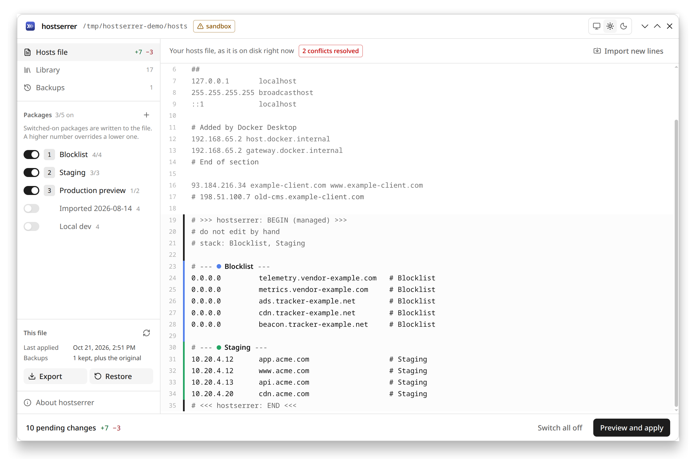
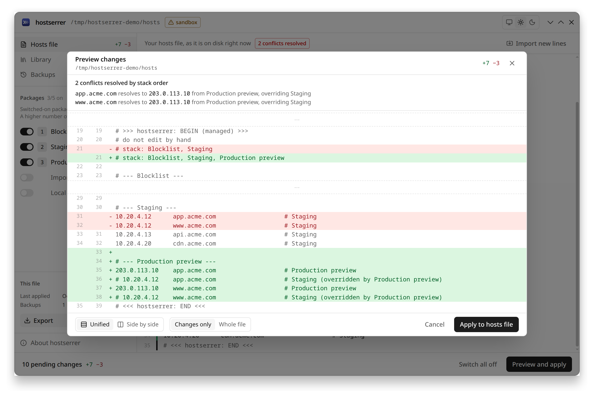
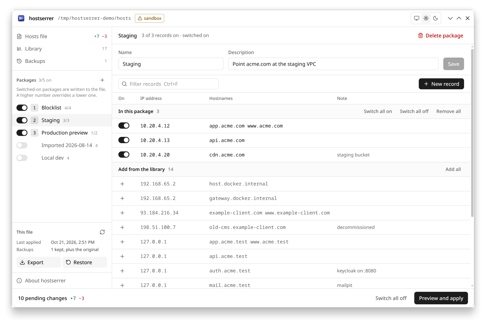
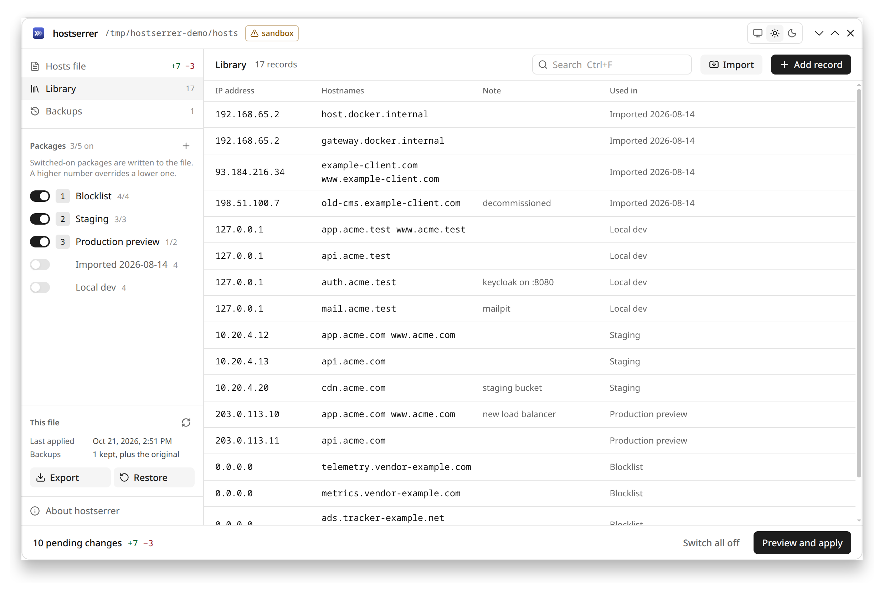
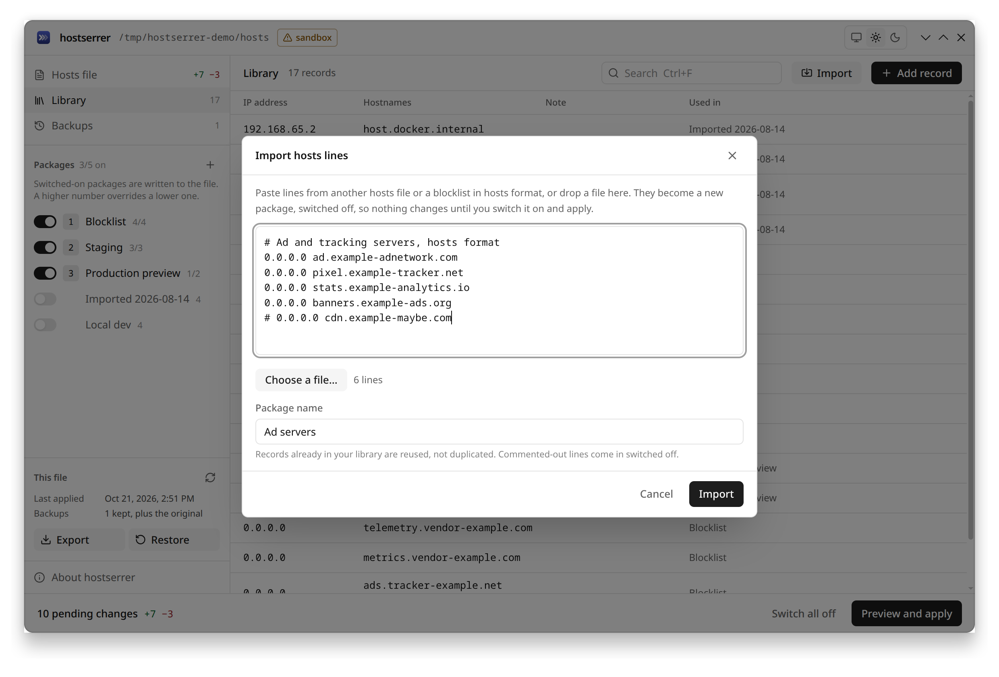
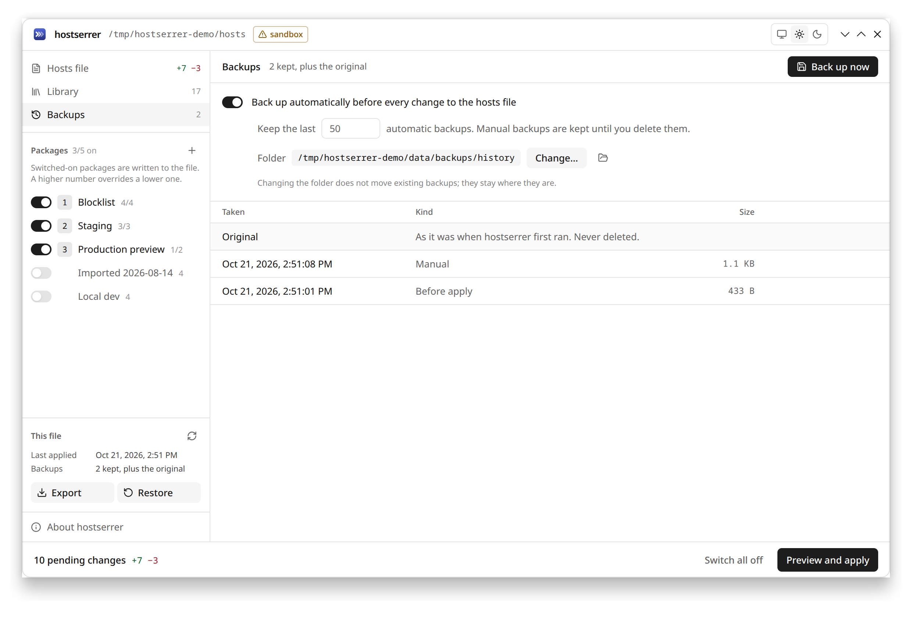
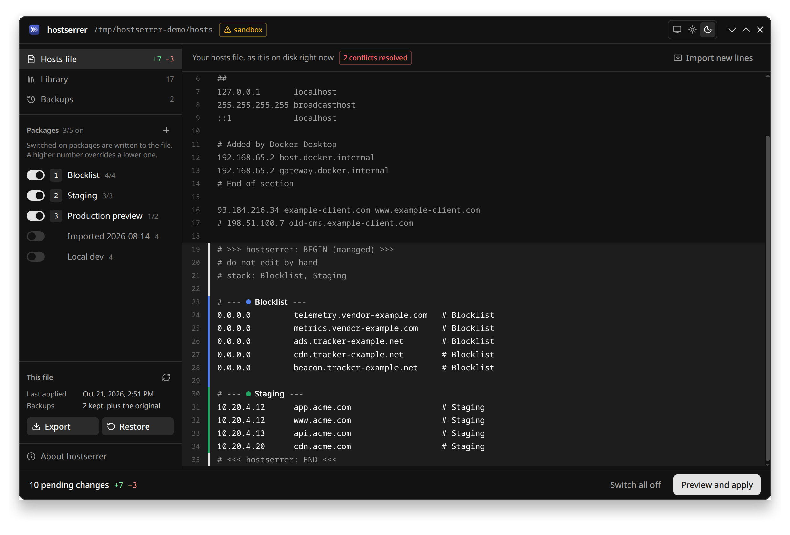
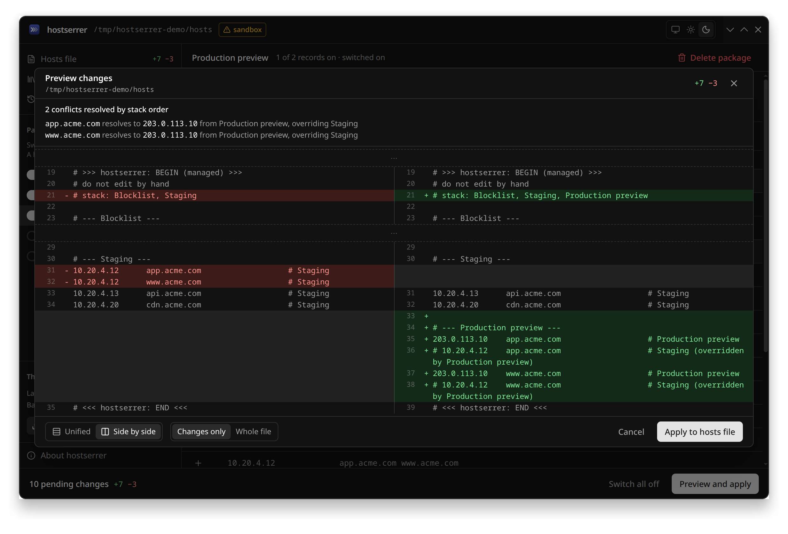
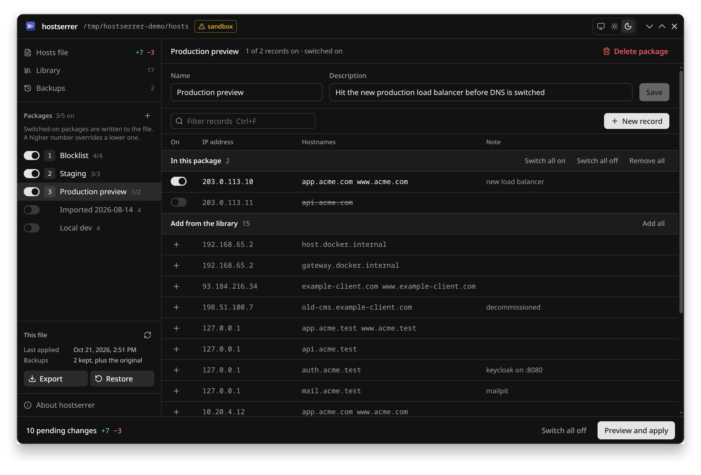

<p align="center">
  
</p>

<h1 align="center">hostserrer</h1>

<p align="center">
  A hosts file manager for macOS, Windows and Linux.<br />
  Keep a library of host records, compose them into packages, switch several on at once,<br />
  and see exactly what will change before anything is written.
</p>

<p align="center">
  <a href="LICENSE"></a>
  
  
</p>



## Why another hosts file tool

Most hosts file editors are file-oriented: you keep several copies of the whole file and switch
between them. That works until you want your ad blocklist on in every environment, or you fix
one IP address and have to find it in six files.

hostserrer is record-oriented.

- **One library** of host records: an IP address, one or more hostnames, an optional note.
- **Packages** reference records from the library. Fix an address once and every package that
  uses it is corrected.
- **A stack** of packages can be on at the same time, in an order you choose. Later packages
  override earlier ones, so "Staging" plus "Blocklist" is a normal thing to run.
- **Per-record switches** inside a package, so you can turn one mapping off without removing it.
- **A preview** of the exact diff before every write, and a backup before every write.

It only ever writes between two marker lines it owns. Everything else in the file, whether
Docker, a VPN client or your own hand edits, is left byte for byte as it was.

## Features

- Library of records with notes, search, inline validation, and per-record tools: ping,
  traceroute, and DNS propagation lookups (Google, DNSChecker, WhatsMyDNS) that open in your
  browser.
- Packages that list their own records first, each switched on or kept but off, with the rest of
  the library below to add from. New records can be created straight into a package.
- Import by pasting lines or dropping a file: another hosts file or a blocklist in hosts format.
  Records the library already has are reused, and the new package starts switched off.
- Built for blocklists: an 80,000-line list imports, previews and applies in well under a second.
- Ordered stack of active packages with conflict resolution. When two packages claim the same
  hostname the later one wins, and the loser is written as a commented line naming the package
  that overrode it, so the file explains itself.
- Preview before apply: unified or side-by-side diff, changes only or the whole file, with
  conflicts listed at the top.
- Lines above the block that the block already covers are commented out, so the block actually
  takes effect, and put back unchanged when the block stops covering them. This is a checkbox
  in the preview and can be turned off.
- First-run import of whatever is already in your hosts file, including commented-out entries,
  which come in switched off. Lines added to the file later are detected and offered for import.
- The original file is captured before the first write and can always be restored. A timestamped
  backup is taken before every apply.
- Export a copy of the file as it is on disk.
- Sortable tables, keyboard shortcuts (⌘/Ctrl+F to search, ⌘/Ctrl+N for a new record,
  ⌘/Ctrl+Enter to preview), light and dark themes, native window chrome on each platform, and
  a sandbox mode for trying things out on a throwaway file.

## Screenshots

**Preview before apply.** Conflicts resolved by stack order, and exactly what will change.



**A package.** Its own records first, each switched on or off, with the rest of the library
below to add from.



**The library.** Every record, its note, and the packages that use it.



**Import.** Paste lines from another hosts file or a blocklist, or drop a file.



**Backups.** Automatic before every change, manual whenever you like, in a folder you choose.



**Dark theme.**







## How it works

### The managed block

hostserrer writes one block into your hosts file:

```
# >>> hostserrer: BEGIN (managed) >>>
# do not edit by hand
# stack: Blocklist, Staging, Production preview

# --- Blocklist ---
0.0.0.0         telemetry.vendor-example.com   # Blocklist

# --- Staging ---
10.20.4.13      api.acme.com                   # Staging

# --- Production preview ---
203.0.113.10    app.acme.com                   # Production preview
# 10.20.4.12    app.acme.com                   # Staging (overridden by Production preview)
# <<< hostserrer: END <<<
```

Each package's lines sit under a heading with its name, in stack order, so anyone reading the
file in a text editor can see where every rule comes from. In the app, each section gets its
own colour and the heading opens the package.

Switching every package off removes the block and its markers, and the file returns to exactly
what it was. Nothing outside the markers is rewritten. The one exception is deliberate and
reversible: a plain entry above the block whose hostnames the block covers would win in the
resolver, so it is prefixed with `# hostserrer moved: ` and restored, byte for byte, once the
block no longer covers it.

### Writing the file

The hosts file is owned by root or by the Administrators group, so every apply asks for your
password through the platform's own dialog: `osascript` on macOS, UAC on Windows, `pkexec` on
Linux. Nothing privileged stays running afterwards. The content never appears on a command
line; it is staged to a temporary file and installed from there.

After writing, the file is read back and compared to what was meant to be written before the
app reports success. If something else changes the file later, the app notices and says so.

### Where your data lives

Your library, packages, settings and backups are plain JSON and plain text files in the app's
user data directory. The About page shows the path. Nothing is sent anywhere. The only network
activity is the ping, traceroute and lookup tools, and only when you run them.

## Install

Download the build for your system from the
[latest release](https://github.com/dimitriostzr/host-file-editor-crossplatform/releases/latest):
a `.dmg` for macOS, an `.exe` installer for Windows, an `.AppImage` or `.deb` for Linux, each for
both Intel/AMD and ARM.

The builds are not code-signed, so the first launch shows a warning:

- **macOS:** open the app once, then go to System Settings → Privacy & Security and click
  **Open Anyway**.
- **Windows:** in the SmartScreen dialog, click **More info** → **Run anyway**.
- **Linux:** writing the hosts file uses `pkexec`, which needs polkit (most desktops have it).

### From source

```bash
git clone https://github.com/dimitriostzr/host-file-editor-crossplatform.git
cd host-file-editor-crossplatform
npm install
npm start
```

Requires Node.js 22.12 or newer.

## Try it without touching your real hosts file

```bash
npm run demo:app            # a realistic hosts file, library and packages in /tmp/hostserrer-demo
npm run demo:app -- --reset # start the demo over from fresh data
```

The demo keeps both the hosts file and the app's own data under one throwaway directory, and a
sandbox file is written directly with no password prompt. The title bar shows the sandbox badge
so you always know which file you are looking at.

To point a normal run at a file of your own:

```bash
HOSTSERRER_HOSTS_PATH=/tmp/sandbox-hosts npm start
HOSTSERRER_DATA_DIR=/tmp/sandbox-data npm start   # optional: separate library and settings too
```

These overrides work only when running from source. The installed release builds ignore them.

## Development

```bash
npm run dev          # launch with hot reload
npm test             # vitest
npm run typecheck    # tsc for main and renderer
npm run check        # typecheck, prettier, tests
npm run demo         # walk through the engine in the terminal, no window
npm run dist         # package an installer for this platform into release/
```

To publish a release, build on each platform with `npm run dist` and attach the files to a
GitHub release with `gh release upload`. Building on macOS needs a Mac, and Windows installers
are best built on Windows. Alternatively, `gh workflow run release -f tag=v<version>` builds all
three in GitHub Actions and attaches them to a draft release. See
`.github/workflows/release.yml`.

The core engine in `src/core/` has no Electron dependency and is tested against real-world
hosts files, including CRLF and Windows fixtures, with a byte-identical round-trip guarantee.
The main process in `src/main/` owns all file access and elevation. The renderer in
`src/renderer/` is a sandboxed React app that talks to main through an explicitly enumerated
bridge and can neither read files nor run commands on its own.

## Status

Unmaintained, provided as is. The engine, the interface and the write path work end to end on
macOS. Windows and Linux elevation are implemented but have had less testing.

I don't take issues, pull requests or support requests. If you want something changed, fork it
and make it your own.

## Licence

hostserrer is released under the [MIT License](LICENSE).

- **Use it** for anything, at home or at work, for free.
- **Fork it, change it, redistribute it**, with or without your changes.
- **Keep the copyright notice** and licence text in any copy you pass on.
- **No warranty.** It edits a system file, so read the preview before you apply.

The release builds bundle third-party open source software, all under permissive licences (MIT,
ISC). Their notices ship with the app in `THIRD_PARTY_NOTICES.txt`, next to Electron's
`LICENSE.electron.txt` and `LICENSES.chromium.html`.

macOS, Windows and Linux are trademarks of their respective owners and are named here only to
say which systems the app runs on. hostserrer is an independent project, not affiliated with or
endorsed by Apple, Microsoft or the Linux Foundation.
